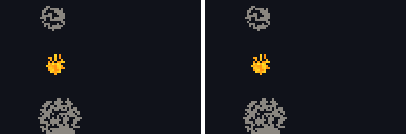

# sogno

**A neural network that dreams a game, one frame at a time.**

sogno (Italian for “dream”) learns to *be* a game by watching it. There is no game engine at play
time: you act, and the network draws what happens next. It is trained on an Apple Silicon Mac with
[MLX](https://github.com/ml-explore/mlx), and the goal is to run the dream in the browser.

The first game is [sabbia](https://github.com/AndreaAcanfora/sabbia), a falling-sand toy: sand piles
up, water levels out, fire spreads along wood, acid eats walls. Its frames are grids of 16 materials,
with fire, smoke, steam and embers split by age (93 classes, see [Age bands](#age-bands)).
The next one is the Game Boy, through the [mattone](https://github.com/AndreaAcanfora/mattone)
emulator (160×144 cells, 4 shades).

> Status: v0.3. A trained model (in `web/model/`) and a [browser demo](https://andreaacanfora.github.io/sogno/)
> where you draw into the real game and the dream side by side. Fire now burns out as it should; lava
> is what still goes wrong: see [What it gets wrong](#what-it-gets-wrong).



## How it works

1. **Data.** `sogno-gen` (Rust) runs the real sabbia engine while a scripted painter plays: it pours
   sand from the top, draws walls, sets wood on fire. Every frame gives one training pair: the world
   after the painter acted, and the world two physics steps later. It records several thousand
   frames a second on one core, so data is never the bottleneck.
2. **Model.** A small U-Net (1.2M parameters by default, small enough to run in a browser later) sees
   the last two frames and a partly hidden next frame, and predicts a material for every hidden cell.
   Frames are discrete, so instead of denoising pixels it fills in a masked frame,
   [MaskGIT](https://arxiv.org/abs/2202.04200) style.
3. **Dreaming.** The next frame starts fully hidden and is revealed in 4 passes, the most confident
   cells first. Each pass sees what earlier passes chose, which keeps two grains of sand from both
   falling into the same hole. The dreamed frame becomes the input for the next one: from then on the
   network only ever sees its own output.

Because sabbia is random (fire flickers, water picks a side), the dream is not supposed to match the
real game cell by cell. It is supposed to *behave* like it: sand should still pile up, and the amount
of water should not drift.

## Train it on your Mac

You need an Apple Silicon Mac, [Rust](https://rustup.rs) and [uv](https://docs.astral.sh/uv/).

```sh
git clone https://github.com/AndreaAcanfora/sogno && cd sogno
uv sync

# 1. Record 2,000 episodes of 300 frames (96x64 cells): ~3.7 GB on disk, under a minute.
cargo run --release --manifest-path gen/Cargo.toml -- --out data/sabbia --episodes 2000

# 2. Train. MLX uses the Mac's GPU on its own; progress and an ETA are printed as it goes.
uv run sogno-train --data data/sabbia --out runs/sabbia
#    Then teach it to recover from its own mistakes (see below), from where it stopped.
uv run sogno-train --data data/sabbia --out runs/unroll --resume runs/sabbia \
  --steps 6000 --unroll 3 --lr 1e-4 --warmup 200

# 3. Watch it dream an episode it never saw, next to the real game.
uv run sogno-dream --model runs/unroll --data data/sabbia --temperature 0 --out dream.gif
uv run sogno-dream --model runs/unroll --data data/sabbia --temperature 0 --score 16   # drift, below
```

On an 8 GB M1, start with a short run to measure speed, then size the real one from the ETA:

```sh
uv run sogno-train --data data/sabbia --out runs/try --steps 500 --eval-every 250
```

If memory is tight, lower `--batch` (default 16). The episodes are read from disk as needed, so
their size does not count against memory. The checkpoint is saved at every evaluation, so a run can
be stopped any time and continued with `--resume runs/sabbia` (the learning-rate schedule restarts).

Useful knobs:

| flag | default | what it does |
|---|---|---|
| `--steps` | 20000 | training steps |
| `--batch` | 16 | frames per step |
| `--width` | 32 | channels at full resolution (model size grows with its square: 64 gives 4.8M) |
| `--blocks` | 1 | residual blocks per level (2 makes the model 1.7M) |
| `--history` | 2 | past frames the model sees: with two, it can tell when an age band is about to tick |
| `--changed-weight` | 10 | extra weight on cells that change: most of a frame sits still |
| `--unroll` | 0 | frames the model dreams itself before each target (about 3x slower per step) |

`sogno-dream` takes `--passes` (model calls per frame) and `--temperature` (0 = always the most likely
material).

## Results

On an M1 Pro (16 GB), the 20,000 base steps take 52 minutes at 6.3 steps/s and the 6,000 unrolled ones
46 minutes at 2.2 steps/s. Predicting one frame from real frames is easy: 98% of cells right, 85% of
the cells that change (a cell whose flame ticks into a younger age band counts as a change). Dreaming
is the hard part, because from the second frame on the network only sees its own output, and its small
mistakes become its next input.

`sogno-dream --score 16` measures that on 16 held-out episodes: how far the dream's mix of materials
(whatever their age) has drifted from the real game's (0 = the same amount of every material, 1 =
nothing in common).

| model | temperature | after 10 frames | 30 | 75 | 150 |
|---|---|---|---|---|---|
| v0.2: elements only, base | 0.5 | 0.056 | 0.148 | 0.394 | 0.614 |
| v0.2: elements only, + unrolled | 0.5 | 0.032 | 0.072 | 0.119 | 0.167 |
| v0.2: elements only, + unrolled | 0 | 0.034 | 0.067 | 0.084 | 0.114 |
| v0.3: age bands, base | 0.5 | 0.072 | 0.137 | 0.142 | 0.203 |
| v0.3: age bands, + unrolled | 1 | 0.039 | 0.113 | 0.281 | 0.429 |
| v0.3: age bands, + unrolled | 0.5 | **0.015** | 0.026 | 0.048 | 0.089 |
| v0.3: age bands, + unrolled | 0 | 0.019 | **0.024** | **0.028** | **0.067** |

**Unrolling** (`--unroll N`, the pushforward trick from neural PDE solvers) is the first thing that
helps. Before each training step, the model dreams up to N frames from a real starting point, with the
painter's strokes applied, and is then asked for the *real* next frame. It learns to steer back towards
the game instead of building on its own errors. Unrolling further (6 frames, 5k more steps) did not
help.

### Age bands

**Showing the age** is the second. Fire, smoke, steam and embers in sabbia die on a hidden countdown
(fire lives 20-40 physics steps, smoke 40-90, steam 60-120, embers up to 140). With plain elements the
network cannot tell a fresh flame from a dying one: it guesses an average chance of dying, and at a
temperature below 1 that small chance gets smaller still. In v0.2 the 16 held-out dreams held 2,964
fire cells after 150 frames, against 106 in the game, and 5,698 smoke against 280.

So the generator now reads each cell's remaining life (`World::life`, added to sabbia for this) and
splits those four materials into bands 4 steps wide (8 for embers): 93 classes instead of 16. A band
is two frames wide and the model sees two frames, so it can tell when a cell will tick into the next
band, and in the last one, that it is about to go out. sabbia's renderer already shades fire by heat
and embers by glow, so this mostly puts on the frame what a player sees. Now the same 16 dreams hold 9
fire cells against 106 (temperature 0) and 21 smoke against 280: fire burns out, a little too early.

Temperature 0 drifts least, and the demo defaults to it. It is also the calmest: something that
happens with a low chance per frame (a drop splashing sideways) rarely happens.

### What it gets wrong

**Lava.** sabbia never makes lava, it can only be painted, but the dream does: after 150 frames the 16
dreams hold 1,571 lava cells against 420 (temperature 0), and 5,476 at 0.5, often as a cloud where
the flames above a lava pool should be. Young fire is spread over several age bands, each one less
likely than lava on its own, and a low temperature favours the single most likely class. Sharpening
the choice of material instead of class (then drawing the age as predicted) made it worse, with
steam taking over. Water also drains away (1,223 cells against 4,239).

## In the browser

The demo runs both worlds side by side: sabbia's real rules on the left (compiled to WebAssembly from
the same revision the training data came from), the dream on the right. Each brush stroke goes into
both. The dreamer runs on your GPU through WebGPU with no ML library: the U-Net is five small compute
shaders in [`web/dreamer.js`](web/dreamer.js), and its logits match MLX's to 1e-5.

```sh
scripts/build-web.sh runs/unroll     # the game as WebAssembly + this checkpoint's weights (2.5 MB, float16)
python3 -m http.server -d web        # then open http://localhost:8000
```

`node web/test/check.mjs` (after `npm ci` in `web/` and `sogno-export ... --golden web/test/golden.bin`)
checks the WebGPU engine against MLX on the same input and drives the demo in headless Chromium.

## Layout

- `gen/`: the data generator, in Rust, using sabbia as a library (the scripted painter and the age
  bands are in `lib.rs`).
- `sogno/data.py`: reads the episodes; `model.py`: the dreamer, its loss and sampler;
  `train.py`, `dream.py` and `export.py`: the commands.
- `web/`: the browser demo. `engine/` is the real game as WebAssembly, `dreamer.js` the network in
  WebGPU, `model/` the trained weights.
- `tests/`: fast checks that run on any CPU (`uv run pytest`).

## License

MIT
